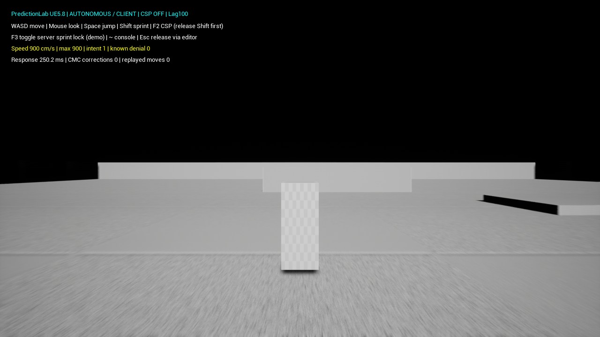
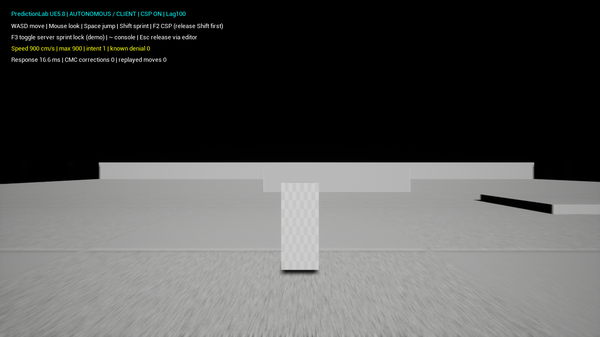
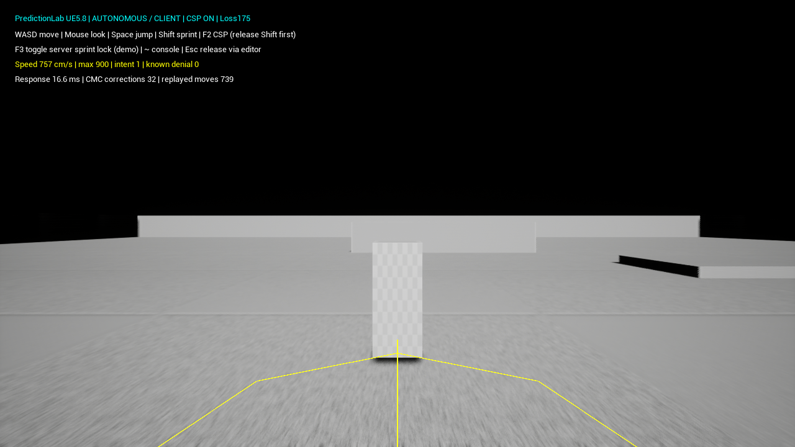
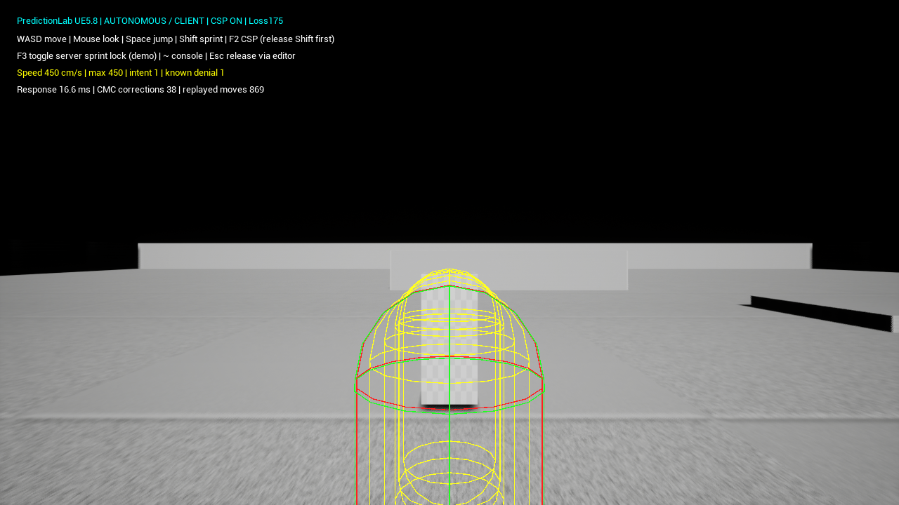

# Подписанная серия скриншотов

Нативные кадры самостоятельной Development-сборки UE 5.8.4.
Код: 533874e8fd92a5cd218548acd1cd581d61902330.
Полные логи и измерения: Results.md и media/run_20261123_195522.

## T2. Спринт без локального предсказания

Профиль Lag100: 100 мс в каждую сторону, потери 0%. HUD: AUTONOMOUS / CLIENT,
CSP OFF. Реакция наступает после baseline_ack от сервера. Значение Response —
фактическое время от Shift до скорости >475 см/с, включая ожидание и разгон.

## T3. Тот же сценарий с предсказанием

Тот же профиль и направление движения. CSP ON: локальное ускорение начинается
до серверного ответа. Сервер повторяет движение с собственными ограничениями.

## T5. Намеренное расхождение и коррекция

Профиль Loss175: 175±25 мс в каждую сторону, потери 5%. Сервер уже запретил спринт,
но владелец ещё не получил это правило: локальный ожидаемый максимум — 900 см/с.

После получения запрета и коррекций CMC максимум на владельце возвращается к 450.
HUD показывает число реальных коррекций и повторно проигранных ходов. Цветные
маркеры создаёт p.NetShowCorrections.

Сопоставлять кадры с trial=20, server_reject, owner_policy, cmc_correction
и auto_complete в журналах. Соединение сохраняется, trial=21 снимает запрет,
trial=22 повторяет обычный спринт.
